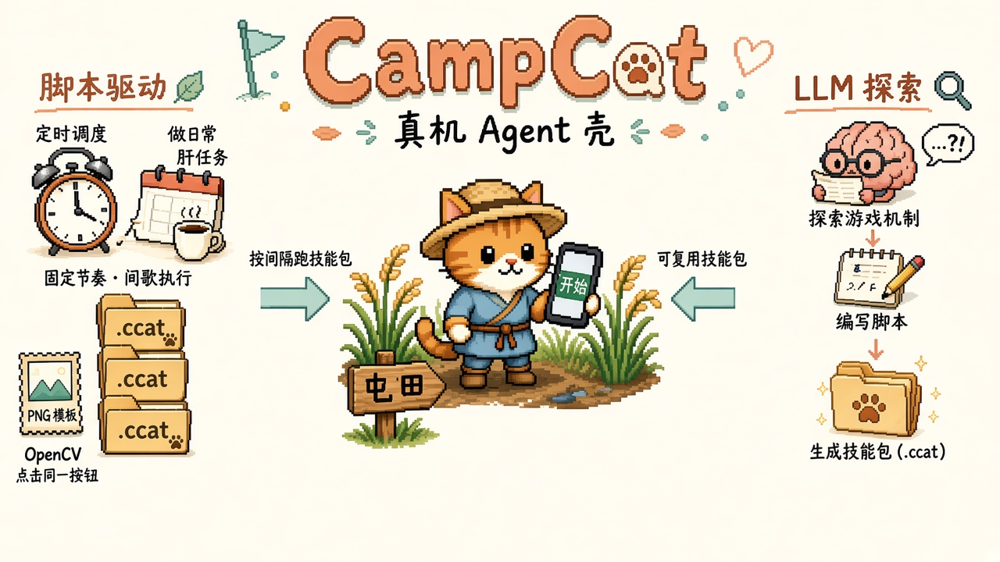
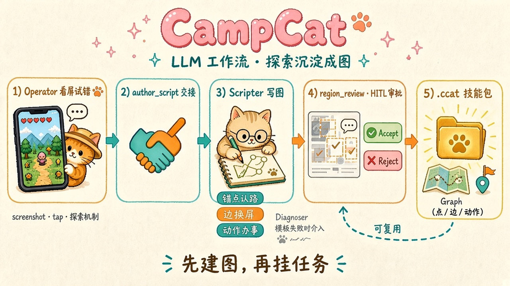
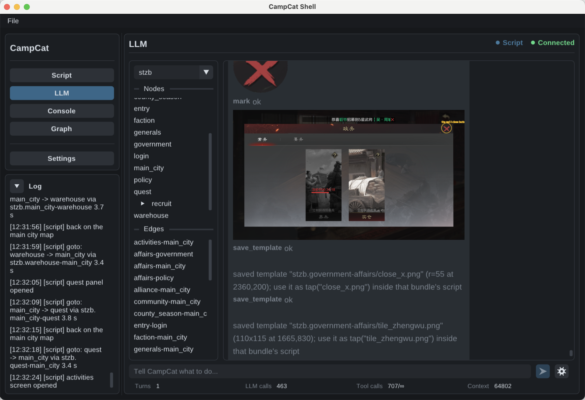
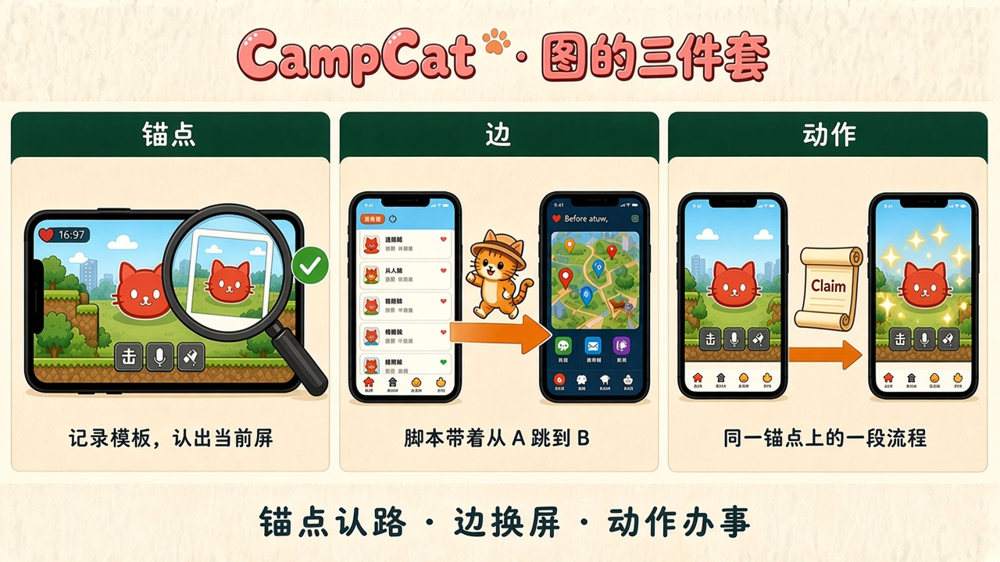
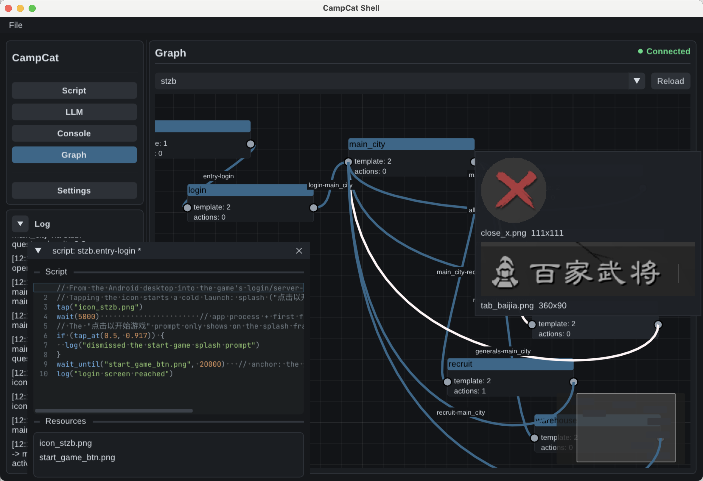
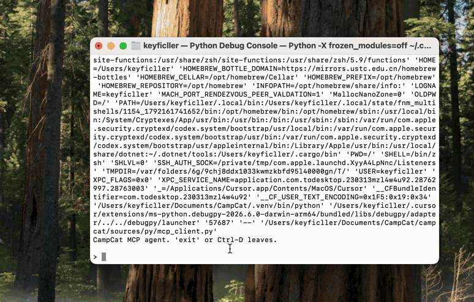

# CampCat

**手机模拟器 Agent 壳** —— 初衷很朴素：手游的日常任务，人不用守着。

## 两条路



**脚本驱动** —— 为了确定性，定时调度的时候不漂移。OpenCV 在本地匹配模板，没有大模型参与：同一个屏幕，每次都是同一串点击，稳定，可复现。技能包是一段 `.ccat` 脚本加上它的模板图，语言见 [CCAT.md](CCAT.md)。

**LLM 探索** —— 为了把写脚本的迭代成本压下来。人只说一句目标，视觉模型看屏幕去探索，跑通的经验写成脚本落盘，再交给上面那条路，本质上是个脚本作者。

## LLM 探索工作流




| Agent         | 何时上场      | 做什么                              |
| ------------- | --------- | -------------------------------- |
| operator      | 和人对话      | 看屏幕、操作设备、跑已有的技能包。写脚本交给 scripter。 |
| scripter      | 被叫来写脚本    | 只看见这次的目标。建图、切模板、跑一遍验证。           |
| diagnoser     | 模板没匹配上    | 看模板和屏幕，告诉 scripter 是重切，还是改上一步。   |
| region review | 按一块区域动手之前 | 对照裁出来的图改到合适。看不清就用原来的。            |


### 边走边写


## 图的三件套




| 落盘图内的元素     | 做什么                   |
| ----------- | --------------------- |
| 锚点（主要认UI前景） | 用这一屏上的模板，判断现在是不是这页。   |
| 边           | 从这一页走到那一页。            |
| 动作          | 从这一页开始把事情做完，结束时还是这一页。 |

### 写成的图


## 技能包仓库

`ccat_library/` 是一个子模块（[CampCat-Packs](https://github.com/KeyFicller/CampCat-Packs)），放 `.ccat` 脚本、模板图和图的描述。语言手册 `CCAT.md`、范例 `gold.ccat` 属于这个仓库，不在包里。

长期记忆使用追加式 JSONL 账本：`<config_home>/memory/operator.jsonl` 放跨图偏好，`<config_home>/<bundle>/memory/operator.jsonl` 放该图的叫法，`scripter.jsonl` 放写脚本的坑和风格（没有选中图时回落到 `memory/`）。每轮发送的是按预算渲染的活跃条目；模型只提议变更，由 C++ 宿主校验并提交。旧 `operator.md` / `scripter.md` 不再自动读取或迁移。会话事件仍在 `<config_home>/turns.jsonl`，尚未迁到项目 `.campcat/`。`config_home` 默认随配置指向脚本库，具体以当前配置为准。

默认不拉取，要用的时候：

```bash
git submodule update --init --checkout ccat_library
```

## 构建与测试

需要 Bloomberg `clang-p2996`（与 Linux 镜像一致的 `9ffb96e3ce36`）、它配套的反射版 libc++、CMake 4、Ninja、带 freetype 的 OpenCV，以及 Python 3.14。普通 Apple Clang / LLVM 尚不能编译这里的反射代码。

macOS 可用 `brew install cmake ninja opencv` 准备依赖，然后从源码构建并缓存编译器：

```sh
export CPPREF_LLVM_ROOT="$HOME/.cache/campcat-clang-p2996"
export CAMPCAT_TOOLCHAIN_WORK="$TMPDIR/campcat-clang-p2996-build"
sh misc/scripts/bootstrap_macos_toolchain.sh
uv venv --python 3.14 .venv
sh misc/scripts/test.sh
```

首次构建编译器耗时较长，后续会复用安装并重新编译一个反射探针。已有完整安装时可直接设置 `CPPREF_LLVM_ROOT`；本机 `CMakeUserPresets.json` 的 `local` preset 也可指定它。OpenCV 未被发现时，在 configure 参数中加 `-DOpenCV_DIR="$(brew --prefix opencv)/lib/cmake/opencv4"`。

`requirements.txt` 保留直接依赖及允许范围，`requirements.lock` 固定 Python 3.14 已测试环境的完整依赖版本；本地测试脚本与 Python CI 都从 lock 安装。改依赖时应同时更新 lock 并跑 Python 测试。lock 未包含发行包哈希。CI 保留 Linux C++ / Python 检查，并在 GitHub 托管 macOS runner 上构建应用、运行核心测试；macOS 冷缓存会构建同一固定版本的编译器。

当前模块职责、协议、落盘路径和恢复边界见 [架构说明](docs/architecture.md)。账本和技能包按单写入进程设计，恢复保证面向进程中断；未通过 `fsync` 承诺断电持久性。

## 作为 MCP 服务启动

```bash
./build/campcat --mcp --graph <图> [config.json]              # stdio
./build/campcat --mcp-http [port] --graph <图> [config.json]  # Streamable HTTP，127.0.0.1:<port>
```

`--graph` 必填：一个服务只服务一张图，缺了就以 2 退出，图名不合法也是 2，库里没有这张图是 1。


