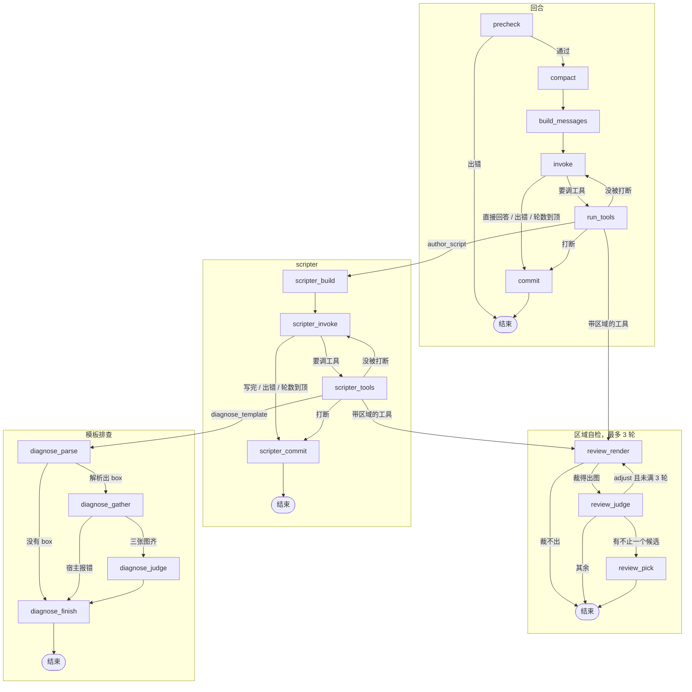

# CampCat

**真机 Agent 壳（C++ / LangGraph / ADB）** —— 自动化从两条路进来：脚本驱动用 `.ccat` + OpenCV 模板匹配确定性执行；LLM 驱动让视觉模型看屏幕做决策，把跑通的流程落盘成可组合复用、持续迭代的技能包。初衷很朴素：手游的日常任务，人不用守着。

## 路径一：脚本驱动（确定性）

目标是**不漂移**：同一个屏幕每次都落在同一串点击上；并且能交给调度器按间隔间歇执行。一条攒下来的流程，跑一百次和跑一次是同一件事。

**技能包** —— `ccat_library/<名字>/`：一个 `main.ccat`，加上它用的模板 PNG。语言见 [CCAT.md](ccat_library/CCAT.md)。

**确定性从哪来** —— 每条提到 PNG 的语句自己截一张图，模板匹配找到元素再点。匹配用固定阈值，全程在本地跑（OpenCV）：没有模型参与，也不碰网络，所以同一个屏幕跑同一个脚本，得到同一串点击。

**失败与锚点** —— 语句失败就停下，错误指向没落地的那一步，不会静默往下跑；`wait_until` 拿「动作成功后才会出现的图」当锚点，断言落点到了哪儿。

**间歇调度** —— `config.json` 的 `scheduler` 配间隔与抖动，周期执行 Script 页选中的那个技能包（`script_bundle`）。

## 路径二：LLM 驱动（探索 → 沉淀成脚本）

目标是**把写脚本的迭代成本压下来**：模型替人做探索和试错，人只审结果。它本质上是个脚本作者 —— 不绕开脚本自己戳屏幕，也不替掉路径一。

**看屏幕 → 写 → 跑 → 改** —— 人只说一句目标；模型自己看屏幕、自己写并运行脚本、看结果、错了自己改。截图交给视觉模型（`deepseek-flash` / `qwen3.8-flash`，LLM 页可切）决定下一步。

**动手只走工具** —— `screenshot` / `tap` / `run_script` / `save_script` … 全部经过解释器；有副作用的工具默认要人点批准。模型给的框通常糙（体感是 Qwen 比 DeepSeek 强），引擎会把它吸附到元素边界上。

**沉淀成技能包** —— 跑通的流程用 `save_script` 落盘，由 `list_scripts` / `read_script` / `update_script` / `delete_script` / `rename_script` 管这个库。

**先建图，再挂任务** —— 模型先把游戏的屏幕建成一张图：每个屏幕是一个锚点（`save_anchor` 写下画面描述和只做判断的脚本），屏幕之间的每次跳转是一条边（一个 `G.a-b` 技能包）；`goto` 沿图走到目标，每一跳都检查两端。任务脚本以 `goto` 开头，挂在图上。所以这条路线的终点是路径一的「图加上图上的任务」：确定的、可调度、可复用的那份。

**跨会话记忆** —— 记录用户习惯和游戏内黑话，落在 `ccat_library/memory.md`。

**LangGraph** —— 一轮对话是下面的回合图。`author_script` 和 `diagnose_template`、以及每次带区域的工具，都在工具节点里另起一张图，不挂在父图上。

