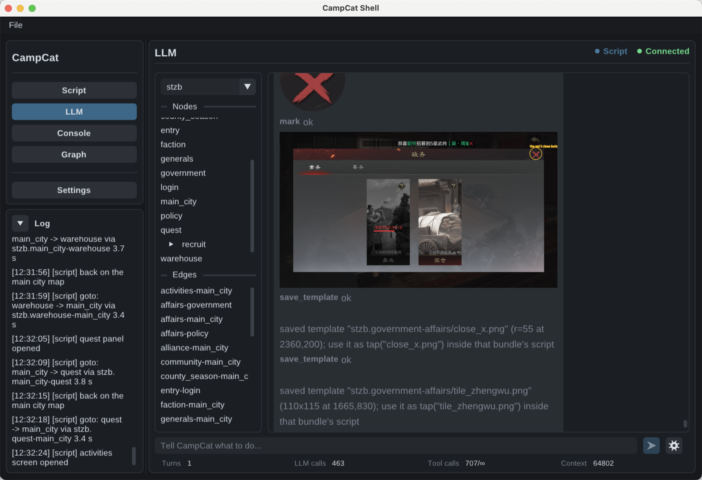
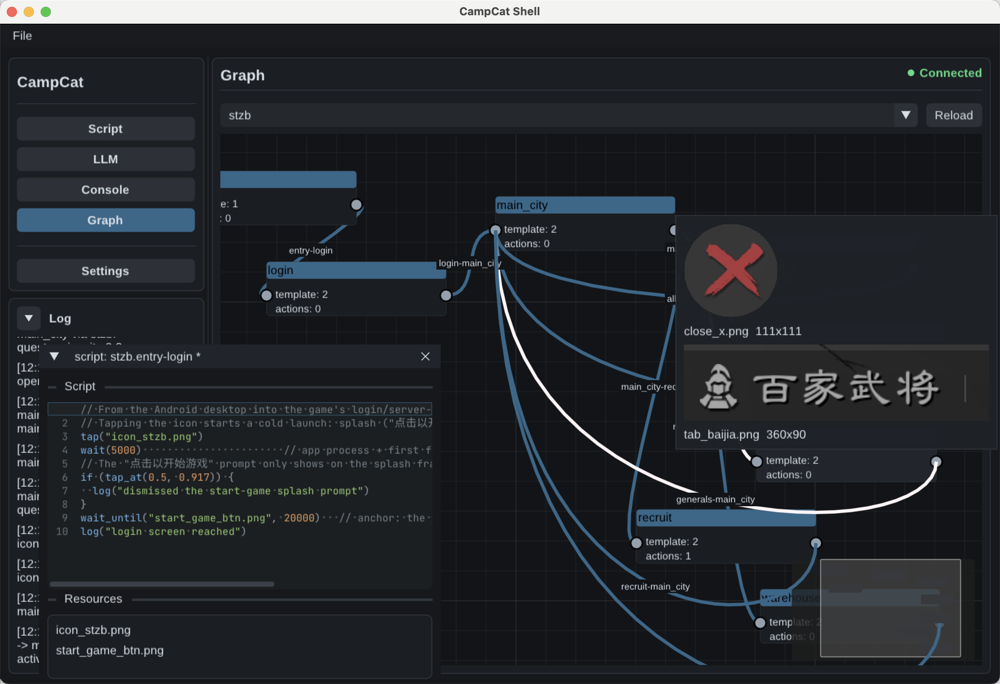

# CampCat

**手机模拟器 Agent 壳** —— 初衷很朴素：手游的日常任务，人不用守着。

## 两条路


**脚本驱动** —— 为了确定性，定时调度的时候不漂移。OpenCV 在本地匹配模板，没有大模型参与：同一个屏幕，每次都是同一串点击，稳定，可复现。技能包是一段 `.ccat` 脚本加上它的模板图，语言见 [CCAT.md](CCAT.md)。

**LLM 探索** —— 为了把写脚本的迭代成本压下来。人只说一句目标，视觉模型看屏幕去探索，跑通的经验写成脚本落盘，再交给上面那条路，本质上是个脚本作者。

## LLM 探索工作流


| Agent         | 何时上场      | 做什么                              |
| ------------- | --------- | -------------------------------- |
| operator      | 和人对话      | 看屏幕、操作设备、跑已有的技能包。写脚本交给 scripter。 |
| scripter      | 被叫来写脚本    | 只看见这次的目标。建图、切模板、跑一遍验证。           |
| diagnoser     | 模板没匹配上    | 看模板和屏幕，告诉 scripter 是重切，还是改上一步。   |
| region review | 按一块区域动手之前 | 对照裁出来的图改到合适。看不清就用原来的。            |


### 边走边写


## 图的三件套


| 落盘图内的元素     | 做什么                   |
| ----------- | --------------------- |
| 锚点（主要认UI前景） | 用这一屏上的模板，判断现在是不是这页。   |
| 边           | 从这一页走到那一页。            |
| 动作          | 从这一页开始把事情做完，结束时还是这一页。 |

### 写成的图


## 技能包仓库

`ccat_library/` 是一个子模块（[CampCat-Packs](https://github.com/KeyFicller/CampCat-Packs)），只放技能包：`.ccat` 脚本、模板图、`operator.md`。语言手册 `CCAT.md`、范例 `gold.ccat` 属于这个仓库，不在包里。

默认不拉取，要用的时候：

```bash
git submodule update --init --checkout ccat_library
```

## 作为 MCP 服务

```bash
./build/campcat --mcp --graph <图> [config.json]              # stdio
./build/campcat --mcp-http [port] --graph <图> [config.json]  # Streamable HTTP，127.0.0.1:<port>
```

`--graph` 必填：一个服务只服务一张图，缺了就以 2 退出，图名不合法也是 2，库里没有这张图是 1。

stdio 上，或者 127.0.0.1 上的 `/mcp`（HTTP 默认端口 8787）上，同一套 MCP 服务，给别的 Agent 用。工具只有这几件：`list_scripts` / `read_graph` / `locate` /
`run_bundle` / `screenshot` / `start_emulator`。没有写入工具，也没有 `run_script` —— 源码入口一旦暴露，
“不能创作”就是假的。客户端能做的只有执行库里已有的技能，外加定位、看屏和开机这几件不落盘的事；
`goto` / `at` / `run` 一旦指向别的图，脚本当场失败，不是换个分支继续。

连上来就会拿到一段说明书（`instructions`，也是 `guide` 这条 prompt）：只讲这一张图的锚点、边与动作、
`goto` 写在脚本里而不在工具面、`run_bundle` 之前先 `read_graph`。不确定设备停在哪一屏时用 `locate`，
它只回一行答案（`stzb.map (page)` / `unknown` / `ambiguous`），不返回画面。脚本跑到 `ask("...")` 会停下来
把问题交给客户端，客户端答完从原处续跑，前面的点击不重放；答不了就停下，不会替你选一个分支。停在问题上
时设备是空闲的，`screenshot` 就是拿来先看一眼再答的——这是它唯一的正当用途。

HTTP 只监听环回地址，没有鉴权：要上云就在前面挂反向代理（TLS、鉴权都在代理上），别指望它自己对外。
走 HTTP 时每个请求都要带 `Mcp-Method` / `MCP-Protocol-Version` / `Mcp-Name` 三个头，否则客户端进不了
modern era，`ask` 会当成答不了；脚本一跑到底，一个请求就开着，客户端自己的超时要留够。